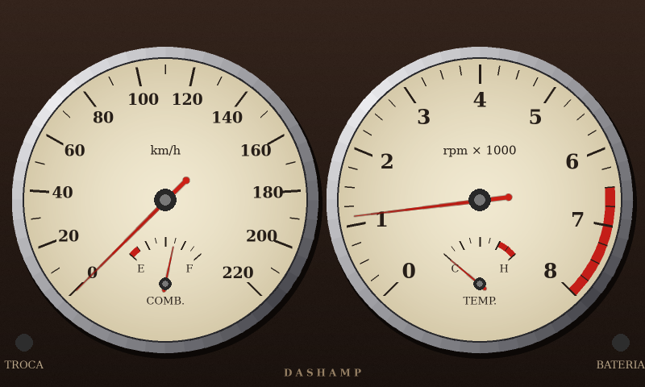
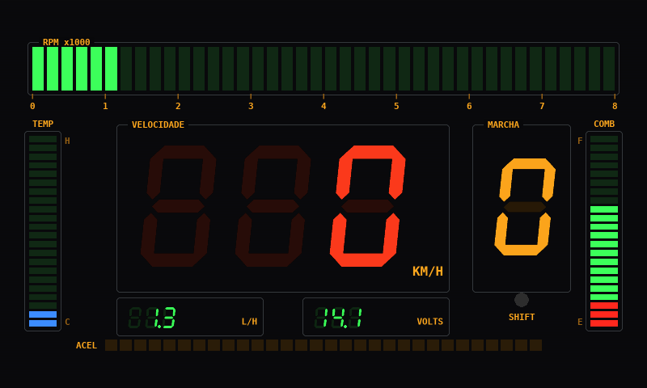
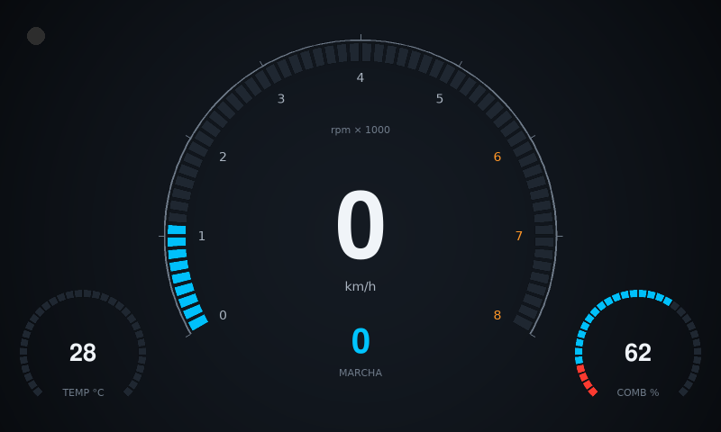
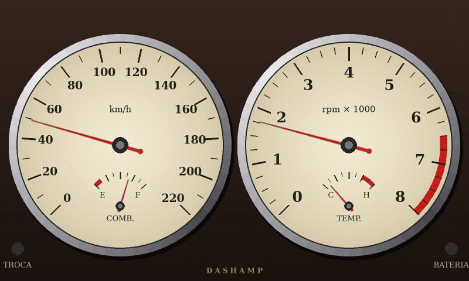
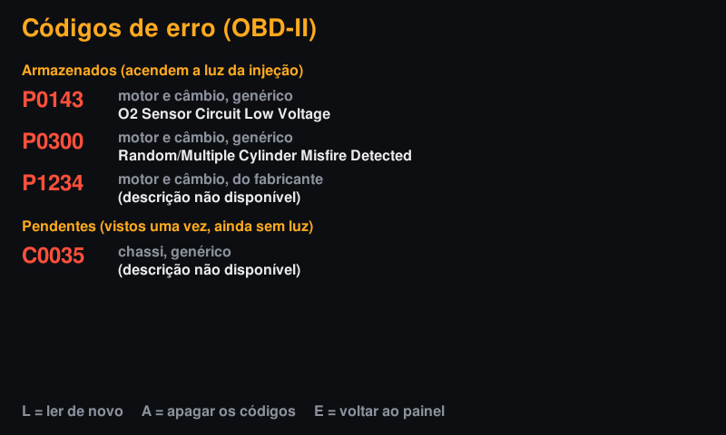

# Dashamp

**Português** · [English](#english)

Dashamp transforma um Linux antigo com tela — um netbook, um Raspberry Pi, um thin client —
em três coisas, nesta ordem:

1. **Player de música** compatível com as skins clássicas do Winamp 2 (`.wsz`), desenhadas pixel a pixel.
2. **Motor de mostradores**: painéis de instrumentos com temas (analógico vintage, digital anos 80,
   moderno) alimentados por qualquer fonte de dados — simulação, replay, telemetria de jogos de
   corrida ou o próprio carro.
3. **Carputer**: o mesmo painel no carro, lendo dados reais via OBD-II (adaptador ELM327), gravando as
   viagens e sincronizando com um servidor.

A máquina de referência é um **ASUS Eee PC 701** (Celeron M 900 MHz, 32 bits, 512 MB de RAM,
tela 800×480). Se roda bem nela, roda em praticamente qualquer coisa: o painel fica em 30 fps
usando de 5 a 50% de um núcleo e cerca de 60 MB de memória.

| Vintage | Digital 80 | Moderno |
| --- | --- | --- |
|  |  |  |

### O que já funciona

- **Player**: skins `.wsz` clássicas (janela principal, playlist e equalizador de 10 bandas),
  analisador de espectro, troca de skin sem reiniciar.
- **Painel**: três temas gerados por código (um formato de tema em JSON para criar outros), troca
  de tema com a tecla T, redesenho só do que muda.
- **Jogos**: **Gran Turismo 7** no PS5 (testado numa corrida de verdade; acha o console sozinho na
  rede) e **F1 24**. Lista de jogos de console com telemetria: [`docs/jogos.md`](docs/jogos.md).
- **Carro (OBD-II)**: leitura por ELM327 com agenda por prioridade e reconexão automática,
  consumo instantâneo e médio (km/L), tela de códigos de erro, diagnóstico do carro. Testado com o
  emulador ELM327; o teste no carro é a próxima etapa.

| Lendo o carro (emulador) | Códigos de erro |
| --- | --- |
|  |  |

**Em andamento:** a fase 3 (carputer). Faltam gravação de viagens, servidor e sincronização e a
instalação no carro. Andamento tarefa a tarefa: [`PLANO.md`](PLANO.md); medições e decisões:
[`docs/estado.md`](docs/estado.md).

### Instalar e usar

Passo a passo (Debian 12, pacotes, boot direto no app, teclas): [`docs/instalacao.md`](docs/instalacao.md).

Teclas principais: **F1** player · **F2** painel com o Gran Turismo 7 · **F3** painel simulado ·
**F4** painel lendo o carro · **F5** diagnóstico do carro · **T** troca o tema.

### Pilha

Python 3.11 · pygame (SDL2) · GStreamer · python-OBD · SQLite · FastAPI (servidor) · Debian 12

### Skins

O Dashamp não distribui skins de terceiros. Use as suas ou baixe skins de teste com
`scripts/baixar_skins.sh` (do [Winamp Skin Museum](https://skins.webamp.org/)).
Winamp é marca registrada de seus respectivos donos; este projeto não tem relação com eles.
Os nomes de jogos citados são marcas de seus donos.

### Licença

[MIT](LICENSE)

---

## English

Dashamp turns an old Linux box with a screen — a netbook, a Raspberry Pi, a thin client — into:

1. **A music player** that renders classic Winamp 2 skins (`.wsz`) pixel by pixel.
2. **A gauge engine**: themed instrument dashboards (vintage analog, 80s digital, modern) fed by any
   data source — simulation, replay, racing-game telemetry, or the car itself.
3. **A carputer**: the same dashboard in the car, reading live OBD-II data through an ELM327 adapter,
   logging trips and syncing them to a server.

The reference machine is an **ASUS Eee PC 701** (900 MHz Celeron M, 32-bit, 512 MB RAM,
800×480 screen). If it runs well there, it runs almost anywhere: the dashboard holds 30 fps on
5–50% of one core and about 60 MB of RAM.

**Working today:** the skinned music player (main window, playlist, 10-band equalizer); three
code-generated dashboard themes plus a JSON theme format; **Gran Turismo 7** (PS5, tested in a real
race, finds the console by itself) and **F1 24** telemetry (see [`docs/jogos.md`](docs/jogos.md#english));
OBD-II reading with priority scheduling, auto-reconnect, fuel consumption (km/L), trouble codes
and a car diagnostics report (tested against the ELM327 emulator; in-car test is next).

**In progress:** phase 3 (trip logging, server, sync, in-car install). See [`PLANO.md`](PLANO.md)
and [`docs/estado.md`](docs/estado.md) (in Portuguese).

**Install and use:** [`docs/instalacao.md`](docs/instalacao.md#english). Keys: F1 player, F2 Gran
Turismo 7 dashboard, F3 simulated dashboard, F4 car dashboard, F5 car diagnostics, T next theme.

Dashamp does not ship third-party skins; fetch test skins with `scripts/baixar_skins.sh`.
Winamp is a trademark of its respective owners; this project is not affiliated with them.
Game names are trademarks of their owners.

License: [MIT](LICENSE)
